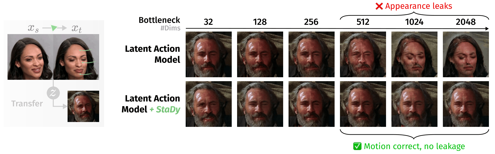

<h1 align="center"> StaDy</h1>

<h2 align="center">
  Factorizing the World into Static and Dynamic via Likelihood Matching
</h2>
<div align="center">
  <a href="https://ffundel.de/">Frank Fundel</a><sup>*</sup> ·
  <a href="https://www.linkedin.com/in/thomas-ressler-494758133/">Thomas Ressler-Antal</a><sup>*</sup>
  <br>
  <a href="https://www.linkedin.com/in/malek-ben-alaya/">Malek Ben Alaya</a> ·
  <a href="https://stefan-baumann.eu/">Stefan Andreas Baumann</a> ·
  <a href="https://ommer-lab.com/people/ommer/">Björn Ommer</a>
</div>
<p align="center">
  <b>CompVis @ LMU Munich, MCML</b>
  <br>
  <i>* equal contribution</i>
  <br>
  NeurIPS 2026
</p>

<p align="center">
  <a href="https://compvis.github.io/StaDy/"></a>
  
  <a href="https://huggingface.co/CompVis/StaDy"></a>
</p>

<p align="center">
  
</p>

## 💡 TL;DR

StaDy learns to separate **what a scene looks like** from **how it changes**.
A motion encoder observes a pair of frames, and a flow-matching decoder combines
the resulting motion representation with a source image to generate the next
frame. A regularization game discourages motion embeddings from carrying the
target's appearance independently of the source, enabling motion transfer
between scenes.

This release includes the openworld and CelebV models, motion extraction and transfer,
and a procedural moving-shapes dataset for training. All model components and
the training objective live in `model.py`.

## 🛠️ Installation

Use Python 3.11 or newer. From this folder, create an environment and install
PyTorch and torchvision for your CUDA version, followed by the dependencies:

```bash
python -m venv .venv
source .venv/bin/activate
pip install -r requirements.txt
```

DINOv2 ViT-L/14 with registers and the TAESD autoencoder are downloaded on first
use and cached by PyTorch Hub and Hugging Face. No video dataset download is
needed for moving shapes.

## 🚀 Train on moving shapes

```bash
python train.py --output outputs/moving-shapes
```

The loader generates pairs of 256 × 256 RGB frames containing moving circles,
squares, triangles, and ellipses. Shapes bounce and rotate against independently
sampled backgrounds. Training uses the full model with a 96-dimensional motion
embedding and a batch size of one per GPU by default. The full model is large;
choose the batch size to fit your GPU memory. Optional bfloat16 autocast is
available with `--precision bf16`.

```bash
# Multiple GPUs: batch size is per GPU.
torchrun --standalone --nproc_per_node=4 train.py --batch-size 4

# Continue from a saved model and optimizer.
python train.py --resume outputs/moving-shapes/latest.pt
```

`--steps`, `--lr`, `--workers`, `--motion-dim`, and `--save-every` control the main
training settings. Checkpoints are saved to `latest.pt`; architecture settings
are also written to `config.json`. Use `python train.py --help` for all options.

## 🎯 Extract motion

Torch Hub exposes the two selected pretrained checkpoints: `openworld` for open-world
motion and `celebv` for faces. Weights are downloaded automatically from
[Hugging Face](https://huggingface.co/CompVis/StaDy) and cached locally.
CelebV requires 637 MB and openworld 3.37 GB of checkpoint storage;
see [selected weights](checkpoints/README.md).

The checkpoints are public; no Hugging Face login or access token is required.

```python
import torch

model = torch.hub.load("CompVis/StaDy", "celebv", device="cuda", trust_repo=True)
# For the open-world model, replace "celebv" with "openworld".

# video: [B, 2, H, W, 3], floating-point RGB in [-1, 1]
with torch.no_grad():
    motion = model.encode_motion(video)
# CelebV: [B, 1, 64, 8]; openworld: [B, 1, 2, 768]
```

Use square frame pairs. For frame generation, spatial dimensions must be
divisible by 16; the supplied example uses 256 × 256 frames.

Load a checkpoint from your own moving-shapes training through the direct API:

```python
from model import StaDy
model = StaDy.from_pretrained("outputs/moving-shapes/latest.pt", device="cuda")
```

## 🎞️ Transfer motion

Apply the motion from one frame pair to a different source image:

```python
# source: [B, H, W, 3], floating-point RGB in [-1, 1]
# motion[:, 0]: motion from the first pair of the reference video
prediction = model.transfer(source, motion[:, 0], steps=50)
# prediction: [B, H, W, 3]; clamp to [-1, 1] for display
```

Try the Figure 1 example with the CelebV model:

```bash
python example_transfer.py
```

The [example inputs](examples/) include the original driving video, the two
selected driving frames, and the recipient start image. The script writes
`examples/prediction.png` and a labeled `examples/transfer.png` preview.

## 🙏 Acknowledgements

Built with [DINOv2](https://github.com/facebookresearch/dinov2),
[minDinoV2](https://github.com/cloneofsimo/minDinoV2),
[TAESD](https://github.com/madebyollin/taesd), and
[Hugging Face Diffusers](https://github.com/huggingface/diffusers).
The release layout is inspired by [WhatMoves](https://github.com/CompVis/WhatMoves).

See [LICENSE](LICENSE) for licensing.
